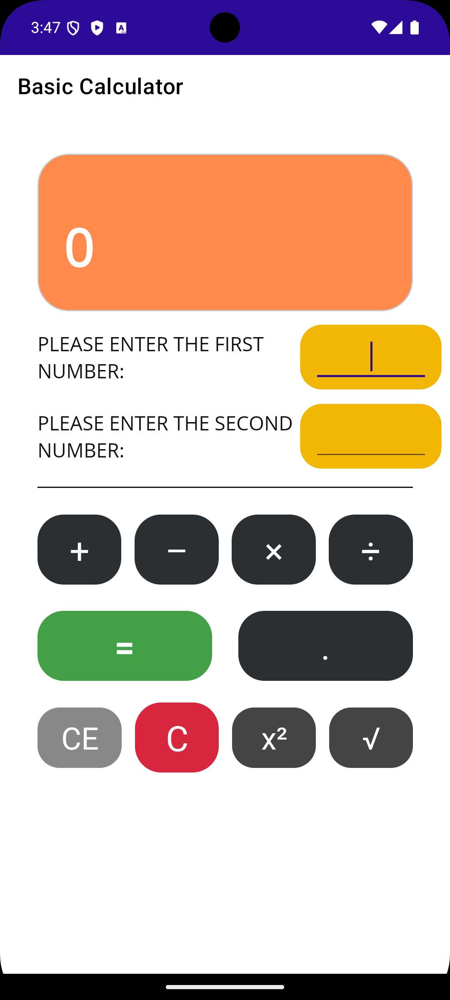

# MauiCalculator

### A simple calculator app built with .NET MAUI, C# and XAML.

A small project focused on UI interaction, input handling and calculator logic, with a custom interface built from reusable XAML styles.

 

---

## About

MauiCalculator started as a small course exercise and gradually became a more complete calculator interface.

I used the project to explore how application state, input validation and visual feedback work together in a .NET MAUI application.

Rather than only implementing arithmetic operations, I also focused on interaction details such as highlighting the selected operator, displaying the current expression and separating full-clear and entry-clear actions.

---

## Preview

  

> A short demo GIF will be added here.

---

## Features

| Feature | 
| --- | 
| Addition, subtraction, multiplication and division 
| Decimal number input 
| Square operation 
| Square root operation 
| Expression preview 
| Clear (`C`) and Clear Entry (`CE`) 
| Input validation 
| Division-by-zero handling 
| Selected-operation visual feedback 

---

## Tech Stack

**Application**
- .NET MAUI
- C#
- XAML
- .NET 8

**UI**
- XAML layouts
- Resource dictionaries
- Reusable styles
- Custom color resources

**Target**
- Android

---

## How It Works

The calculator follows a simple two-value interaction flow:

    First value
        ↓
    Select an operation
        ↓
    Second value
        ↓
    Calculate
        ↓
    Result + expression preview

Unary operations such as square and square root are applied to the currently active input.

Application state keeps track of:

- the currently selected operation
- the active input field
- the two numeric values
- the previously selected operator button

This keeps the interface and calculation logic synchronized while the user interacts with the app.

---

## Project Structure

    MauiCalculator/
    │
    ├── MainPage.xaml
    ├── MainPage.xaml.cs
    │
    ├── App.xaml
    ├── App.xaml.cs
    ├── AppShell.xaml
    ├── AppShell.xaml.cs
    │
    ├── MauiProgram.cs
    │
    ├── Resources/
    │   ├── AppIcon/
    │   ├── Fonts/
    │   ├── Images/
    │   ├── Splash/
    │   └── Styles/
    │       ├── Colors.xaml
    │       └── Styles.xaml
    │
    └── Platforms/

The visual resources are separated from the page logic through XAML resource dictionaries, keeping colors and reusable component styles centralized.

---

## Getting Started

### Requirements

- .NET 8 SDK
- .NET MAUI workload
- Android SDK
- Android emulator or compatible Android device

### Clone

    git clone https://github.com/mervka/MauiCalculator.git
    cd MauiCalculator

### Restore dependencies

    dotnet restore

### Run

Open `MauiCalculator.sln` with Visual Studio or JetBrains Rider and select an Android target.

You can also build the project from the command line:

    dotnet build

---

## What I Practiced

This project gave me hands-on practice with:

- building mobile interfaces with XAML
- handling UI events in C#
- managing simple application state
- validating user input
- handling edge cases such as division by zero
- using resource dictionaries for reusable UI styles
- separating presentation and interaction logic
- working with the .NET MAUI project structure

---

## Next Improvements

The project is intentionally small, but there are several directions I could take it further:

- calculation history
- keyboard input
- scientific operations
- light and dark themes
- improved responsive layouts
- automated tests for calculator logic
- moving calculation logic out of the page code-behind
- MVVM-based state management

---

## Background

This project originally started as a course exercise and was later extended with additional operations, UI states and a custom interface.

I keep it public as a small snapshot of my .NET MAUI learning process and as a reference project for mobile UI and interaction fundamentals.

---

Built with .NET MAUI · C# · XAML

